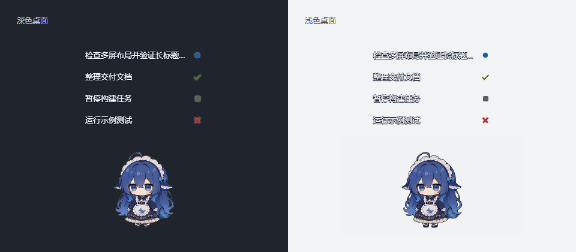

# Codex 外置桌宠

本项目是基于 [DSH-PET（PC2005-cloud/dsh-pet）](https://github.com/PC2005-cloud/dsh-pet) 做的 Codex 桌面版适配，主要是为了方便我自己在用 Codex 时也能用上这只桌宠。感谢原作者 PC2005-cloud。桌宠作为独立的 Windows 程序运行，是个人维护的非官方项目。

- 启动联动后，桌宠跟随 Codex 桌面版显示；Codex 完全退出后，桌宠也会退出。
- 同时显示多条本机 Codex 会话的状态：蓝点运行中，绿勾已完成，灰方块已停止，红叉失败。点击条目可以回到对应会话；已读的终态只清除该条。
- 会话状态由本机日志里的生命周期事件和会话标题生成。“完成”指当前一轮回复结束。桌宠不提供会话聊天功能，也无需配置模型 API。

## Windows 使用

仓库提供适配代码、配置和构建说明。需要 Windows x64、Codex 桌面版和 Node.js 24。首次运行请按[构建与安装](docs/maintenance.md#构建与安装)准备 Electron 并生成本地安装目录。

| 操作 | 入口 |
| --- | --- |
| 开启或恢复联动 | 双击生成的 `install/bridge/start.vbs` |
| 关闭联动和桌宠 | 双击生成的 `install/bridge/stop.vbs` |
| 调整大小、位置和边距 | 编辑 `install/data/dsh-pet/main-config.jsonc` 后重启 |

会话识别依赖 Codex 保存到本机的桌面会话记录。Codex 更新后如发现状态识别有变化，可参考[维护说明](docs/maintenance.md)排查。

## 来源与许可

- **原项目**：[PC2005-cloud/dsh-pet](https://github.com/PC2005-cloud/dsh-pet)。本适配基于 `0.3.8` 系列的 Windows 测试底包。
- **代码**：保留原作者版权声明及 [MIT 许可证](LICENSE)。应用中打包的第三方依赖见[第三方许可](THIRD_PARTY_NOTICES.md)。
- **角色与素材**：动画和角色图像来自 DSH-PET。角色「大肥鱼」为社区二创，原型「溟月」来自 [@上善无形](https://space.bilibili.com/4456176)，女仆鲸鱼娘版设计来自 [@ZipZipPipe](https://space.bilibili.com/4168597)。角色素材及含该形象的演示图遵循 [CC BY-NC-SA 4.0](https://creativecommons.org/licenses/by-nc-sa/4.0/deed.zh-hans)，需署名、不得商用，改编后须按相同许可分享。原动画未改动，演示图在角色旁添加了适配界面。见[上游许可说明](https://github.com/PC2005-cloud/dsh-pet#许可)和[形象授权声明](https://www.bilibili.com/opus/1247156596114456581)。
